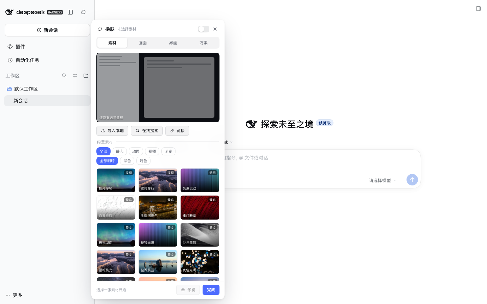
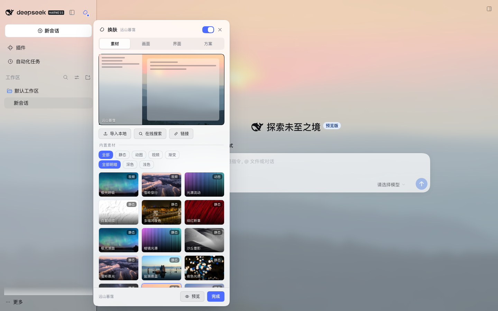
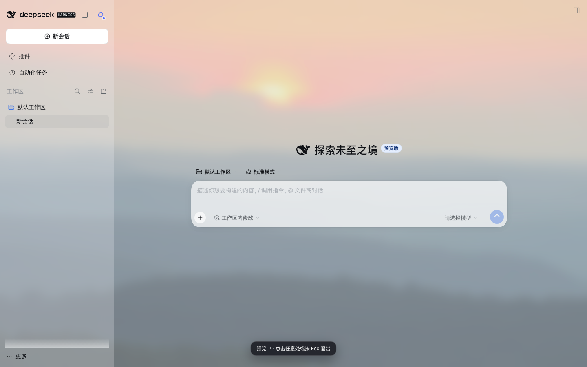

# dsh-skin · DSH 换肤

[GitHub](https://github.com/kaivenw/dsh-skin) · [Gitee](https://gitee.com/CodealienMan/dsh-skin) · [MIT License](LICENSE)

给 DeepSeek Harness 的 Web GUI 换背景皮肤：静态图片、动图（GIF/WebP/APNG）、视频、纯 CSS 渐变都能当壁纸；界面用「主题 token 覆盖 + 毛玻璃」透出壁纸，可单独调透明度、模糊、暗化、缩放、适配方式，支持本地素材、内置精选与在线搜索，实时预览、方案保存与自动轮换。







## 功能

**壁纸**
- 静态图片（JPG/PNG/WebP/AVIF）、动图（GIF/WebP/APNG）、视频（MP4/WebM）、CSS 渐变/网格
- 内置 21 个素材（12 张壁纸 + 3 个动态 + 6 个渐变）、15 张缩略图，授权见 [docs/ATTRIBUTION.md](docs/ATTRIBUTION.md)
- 本地导入（按钮 / 拖拽 / 选择多个）、粘贴图片或视频直链
- 在线搜索四档来源：**自动**（国内 360 + 国外 Openverse/Wikimedia 并发，谁先回先用谁）、**国内**（360 图片）、**国外**（Openverse + Wikimedia，CC 授权）、**必应壁纸**（Bing 每日壁纸，免关键词）
- 实测（本机）：国内约 0.6s 出结果、必应约 0.2s、国外约 1.3s（缓存命中即时）；结果缓存 30 分钟
- 适配：填满裁切 / 完整显示 / 拉伸铺满 / 平铺，五档对齐，1–200% 缩放，按窗口自适应

**画面参数**
- 壁纸不透明度、模糊、亮度、对比度、饱和度、色相、压暗、暗角、颗粒
- 动效：Ken Burns 缓慢推拉、鼠标视差、遵循系统「减少动态效果」
- 视频：静音 / 循环 / 切后台暂停 / 0.25–2× 播放速度

**界面透明（透明体 / 玻璃）**
- 跟随皮肤（自动对比度）/ 清晰 / 玻璃三档预设，最低实度（0.2–1）、玻璃模糊（0–60px）、侧栏实度、输入框实度、正文可读性保护
- **默认回到最初交付的玻璃效果**：实度 0.4、玻璃模糊 12px，壁纸明显透出，标题栏/标签页继承同一层；侧栏同材质
- 「界面」页可选「跟随皮肤（自动对比度）」按壁纸明暗自动调实度，或「清晰（0.88 接近原样）」
- 走官方 `ctx.theme.overrideTokens` 覆盖 `--dsw-alias-bg-base` / `--dsw-specific-sidebar-fill`，不依赖构建哈希类名，卸载自动回收
- 省电模式：关闭全屏毛玻璃与颗粒

**其他**
- 实时预览、全屏预览（隐藏面板，点任意处或 Esc 退出）
- 方案保存 / 应用 / 删除，设置 JSON 导出导入
- 自动轮换：每次启动 / 每小时 / 每天，只换素材不动参数
- 快捷键 `⌘⇧K` / `Ctrl+Shift+K` 开关面板；Escape 关闭
- 设置存 localStorage，本地素材存 IndexedDB（图片导入时降采样到 1920px 并另存 360px 缩略图，动图/视频保留原文件）
- 轻量策略：内置壁纸按屏幕选 960 / 1600 / 2400 宽变体；视频/动图壁纸自动把玻璃模糊压到 8px；低配机首次加载自动进省电模式

## 安装

### 推荐：侧栏「插件」页

DSH 侧栏 →「插件」→ 添加插件 → 粘贴本目录绝对路径 → 安装 → 启用。插件管理器会即时应用，刷新页面后左侧 logo 行右端出现调色盘图标。

### 或：命令行

```bash
node scripts/install-profile.mjs          # 默认 ~/.dsh/profiles/desktop
# 或：node scripts/install-profile.mjs --profile ~/.dsh/profiles/web
```

macOS 没装 Node.js 时双击 `install.command`。安装后**重启 DSH** 生效；卸载加 `--uninstall`。

## 使用

点侧栏 logo 行右端的调色盘图标打开面板（折叠侧栏时按钮自动隐藏）：

| 页签 | 内容 |
|---|---|
| 素材 | 实时预览卡、导入本地、在线搜索、链接、内置素材（按静态/动图/视频/渐变 + 深色/浅色筛选）、本地素材 |
| 画面 | 适配方式与对齐、缩放、不透明度、模糊、亮度/对比度/饱和度/色相、压暗/暗角/颗粒、动效、视频参数 |
| 界面 | 跟随皮肤/清晰/玻璃预设、自动对比度、最低实度、玻璃模糊、侧栏实度、输入框实度、正文可读性保护、省电模式、压暗色调 |
| 方案 | 保存当前为方案、应用/删除、导出导入 JSON、自动轮换；底部「重置」分组可恢复默认设置 |

调参实时生效；面板右上角开关可临时停用换肤而不丢设置。右上角 ↺ 与「方案 → 重置」都能恢复默认设置：关闭换肤、清空当前素材选择、参数回默认，保留本地素材和已保存方案，操作前有确认弹窗。

## 开发

```bash
npm install        # 只为构建客户端 bundle（esbuild）
npm run build      # client/*.jsx -> client.js
```

- 客户端 bundle 是 `window.__ModuleLoader__.load({ id, factory })` 信封，运行时只 require 平台 seed 模块（react / react-dom / react/jsx-runtime）。
- 宿主半侧 `index.js` 注册四个同源路由：`/dsh-skin/assets/*`（素材，支持 Range）、`/dsh-skin/api/materials`（素材清单）、`/dsh-skin/api/search`（在线素材搜索）、`/dsh-skin/api/image`（远程图片代理，绕开 ORB/防盗链，限 https + 25MB）。
- 壁纸层是 `position:fixed; z-index:-1` 的 React 层；界面透明靠主题 token 覆盖 + 少量外壳容器置透明，不使用哈希类名。
- 结构：`client/index.jsx`（挂载 / 触发按钮 / 状态）、`client/engine.js`（样式与壁纸层）、`client/panel.jsx`（面板）、`client/settings.js`（参数与持久化）、`client/media.js`（IndexedDB）、`client/materials.js`（素材与搜索）。

## 内存与省电

| 项 | 上限 / 策略 |
|---|---|
| 当前壁纸解码 | 只解一张；按屏幕像素选 960/1600/2400 宽变体（1440 屏约 5.8MB，而不是 2400 原图的 13MB） |
| 素材缩略图 | 内置 480×270、本地 360px，列表 lazy-load，不把原图当缩略图解码 |
| 在线图片代理缓存 | 宿主内存上限 48MB（单图最多 12MB），LRU 淘汰 |
| 本地素材 | 单图 ≤80MB、单视频 ≤200MB；IndexedDB 总量接近 1.2GB 时拒绝导入；面板可看占用并一键清空 |
| 视频壁纸 | 单实例、切后台暂停；玻璃模糊自动压到 ≤8px；默认静音循环 |
| 毛玻璃 | 全屏 backdrop-filter 可一键关闭（界面 → 省电模式）；低配机（≤4 核或 ≤4GB 内存）首次加载默认开启 |
| 卸载 | 画布/视频/object URL/新增变量/token 覆盖全部回收 |

仍有开销、但可控的地方：视频解码本身吃 CPU/GPU（与外层插件无关，建议 1080p、≤200MB）；超宽/4K 屏会选 2400 原图（约 13MB）；远程大图经代理限 12MB，但解码尺寸取决于源图。觉得重就开省电模式、把「玻璃模糊」拉到 0，或在「本地素材」里清空不用的文件。

## 已知边界

- 只支持 Web GUI（桌面端与 `dsh web` 同一套前端）；未做 Windows 标题栏与 macOS 红绿灯的专门避让，壁纸铺在它们之下。
- 在线搜索：国外源受 Openverse / Wikimedia 匿名配额限制；国内 360 图片为聚合搜索，**版权归原作者，仅建议个人使用**，不要用于商业分发或再发布。
- 素材授权见 `docs/ATTRIBUTION.md`：CC0 / Public Domain / CC BY，CC BY 素材保留署名信息。
- 全屏毛玻璃每帧都要做一次高斯，视频壁纸 + 高模糊在低端机可能掉帧，可开省电模式或降低玻璃模糊。

## License

MIT。素材授权见 [docs/ATTRIBUTION.md](docs/ATTRIBUTION.md)。
